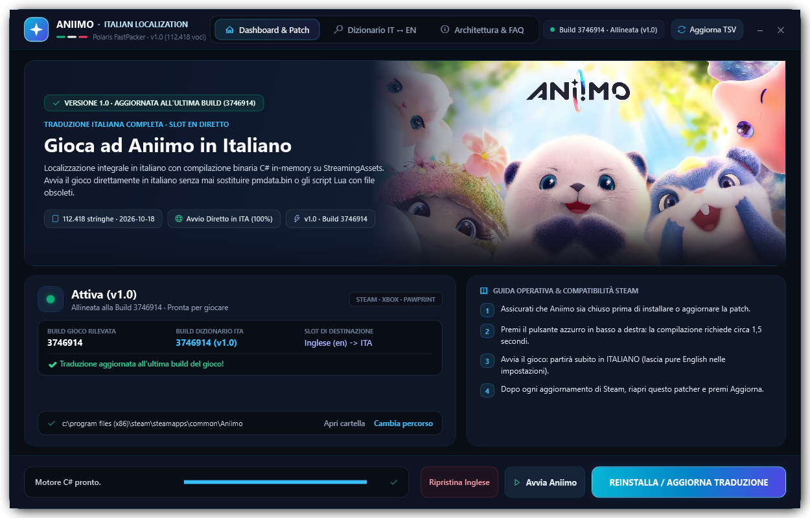
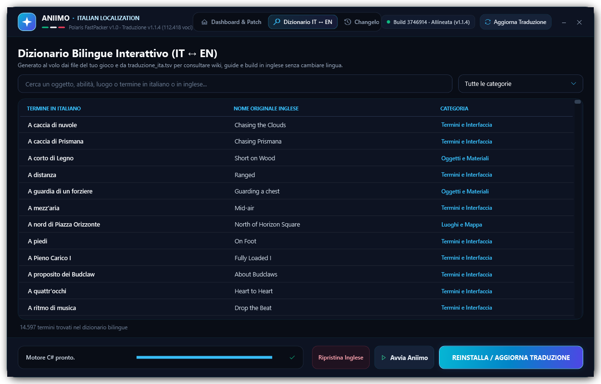

<div align="center">

# 🇮🇹 Aniimo — Traduzione Italiana Integrale
**Launcher & Patcher Leggero Universale per PC (Steam · Xbox App · Pawprint Client)**

[](https://github.com/NobodySan97/Aniimo-ITA/releases/latest)
[](https://github.com/NobodySan97/Aniimo-ITA/releases/latest)
[](#stato-della-traduzione-e-copertura)
[](https://github.com/NobodySan97/Aniimo-ITA/releases)
[](https://github.com/NobodySan97/Aniimo-ITA/releases/latest)


<br>

<p align="center">
  
</p>

*Localizzazione completa in lingua italiana per **Aniimo**. Patcha e compila i testi in tempo reale direttamente sui file della tua build locale, senza ridistribuire script Lua o file binari proprietari (`pmdata.bin`) obsoleti.*

</div>

---

## 🌟 Caratteristiche Principali

- 📜 **100% dei Testi Tradotti (112.418 stringhe)**: Storia principale, missioni secondarie, abilità, statistiche di combattimento, descrizioni oggetti, arredi, interfaccia utente e nomi ufficiali delle specie Aniimo.
- 🚀 **Avvio Diretto in Italiano**: La traduzione va a sostituire lo slot lingua inglese (`en`), avviando il gioco immediatamente in italiano senza dover impostare o selezionare lingue secondarie nei menu.
- ⚡ **Compilazione In-Memory C# (`AniimoFastPacker`)**:
  - Non sovrascrive né include file `.bin` o script `.lua` di vecchie versioni del gioco.
  - Genera al volo l'archivio `LuaScripts.xdf` aggiornando l'indice `LuaScripts.xdt` in meno di 1,5 secondi.
  - **Immune a rotture post-aggiornamento**: se Steam aggiorna il gioco con nuove meccaniche o script, l'installer inietta la traduzione direttamente nella nuova versione preservandone il codice intatto.
- 📖 **Dizionario Bilingue Integrato (IT ↔ EN)**: Oltre 18.000 termini ufficiali (oggetti, abilità, materiali, luoghi e creature) ricercabili istantaneamente all'interno del launcher per consultare wiki, guide e build in inglese senza dover cambiare la lingua di gioco.
- ☁️ **Sincronizzazione Automatica Cloud**: Pulsante *Aggiorna TSV* dedicato per verificare e scaricare in pochi istanti gli ultimi affinamenti del dizionario direttamente da GitHub, senza dover riscaricare l'intero pacchetto ZIP.
- ⏪ **Ripristino Sicuro in 1 Clic**: Ripristina i file originali in inglese istantaneamente, senza bisogno di verificare l'integrità dei file su Steam o riscaricare dati.

---

## 📖 Dizionario Bilingue Interattivo

<p align="center">
  
</p>

Grazie al motore di indicizzazione interno, la scheda **Dizionario IT ↔ EN** indicizza al volo tutti i termini del gioco:
- **Ricerca bidirezionale in tempo reale**: digita qualsiasi nome in italiano o in inglese.
- **Filtro per categorie**: *Termini e Interfaccia*, *Oggetti e Materiali*, *Luoghi e Mappa*, *Abilità e Combattimento*.
- **Zero file spazzatura**: i termini vengono estratti direttamente dagli archivi di gioco e dal file TSV senza occupare spazio aggiuntivo su disco.

---

## 📊 Stato della Traduzione e Copertura

| Parametro | Dettaglio |
| :--- | :--- |
| **Versione Traduzione** | **v1.0** (18 Ottobre 2026) |
| **Build Gioco Verificata** | **Build `3746914`** |
| **Voci Tradotte** | **112.418 su 112.418** (100% copertura verificata) |
| **Nomi Creature Aniimo** | Nomi ufficiali preservati e allineati al canone |
| **Piattaforme Supportate** | ✅ **Steam** · ✅ **Xbox App (PC Game Pass)** · ✅ **Client Pawprint** |
| **Slot di Destinazione** | **Inglese (`en`)** → Avvio automatico in Italiano |

---

## 📥 Come Installare la Traduzione

### Metodo 1: Installazione con Interfaccia Grafica (Consigliato)

1. Scarica l'archivio **`Aniimo_Traduzione_ITA_v1.0.zip`** dalla pagina [Releases](https://github.com/NobodySan97/Aniimo-ITA/releases/latest).
2. Estrai l'archivio in una cartella a piacere (es. sul Desktop).
3. Assicurati che **Aniimo sia chiuso**.
4. Fai doppio clic su **`Installa Traduzione ITA.bat`**.
5. Il launcher rileverà automaticamente il percorso di installazione di Aniimo (Steam, Xbox o Pawprint).
6. Premi il pulsante **`INSTALLA / AGGIORNA TRADUZIONE`** in basso a destra (l'operazione richiede circa 1,5 secondi).
7. Clicca su **`Avvia Aniimo`** (oppure avvialo normalmente da Steam): il gioco partirà subito in italiano!

---

### Metodo 2: Utilizzo da Riga di Comando (CLI / Silent)

Per gli utenti avanzati o per automatizzare l'installazione, è possibile eseguire lo script direttamente con PowerShell:

```powershell
# Installazione automatica senza interfaccia
powershell.exe -NoProfile -ExecutionPolicy Bypass -File "dati\installer.ps1" -Install

# Ripristino della lingua inglese originale
powershell.exe -NoProfile -ExecutionPolicy Bypass -File "dati\installer.ps1" -Restore

# Verifica e sincronizzazione aggiornamenti da GitHub
powershell.exe -NoProfile -ExecutionPolicy Bypass -File "dati\installer.ps1" -CheckUpdate
```

---

## 🔄 Cosa Fare Dopo un Aggiornamento del Gioco

Quando Aniimo riceve una nuova patch o aggiornamento su Steam:
1. Lascia che Steam completi il download dell'aggiornamento.
2. Apri **`Installa Traduzione ITA.bat`**.
3. Premi **`REINSTALLA / AGGIORNA TRADUZIONE`**.
4. L'installer leggerà la nuova patch e inietterà i testi italiani sui nuovi file aggiornati.

---

## ❓ Domande Frequenti (FAQ)

<details>
<summary><b>1. C'è rischio di ban giocando online o in cooperativa?</b></summary>
<br>
<b>Assolutamente no.</b> La traduzione modifica esclusivamente i testi localizzati all'interno della cartella client del gioco. Non altera la logica di gameplay, non tocca la memoria in esecuzione (RAM), non utilizza cheat engine o DLL injection e non modifica parametri di rete.
</details>

<details>
<summary><b>2. L'installer non trova la cartella di Aniimo in automatico, cosa faccio?</b></summary>
<br>
Se hai installato Aniimo su un disco secondario o in una libreria personalizzata, clicca sul pulsante <b>"Cambia percorso"</b> nella dashboard del launcher e seleziona manualmente la cartella principale di Aniimo (quella che contiene l'eseguibile <code>Aniimo.exe</code> o la cartella <code>Aniimo_Data</code>). Il percorso verrà memorizzato automaticamente per i futuri avvii.
</details>

<details>
<summary><b>3. Come posso tornare all'inglese originale?</b></summary>
<br>
Basta aprire il launcher e cliccare sul pulsante <b>"Ripristina Inglese"</b>. I file originali della tua build verranno ripristinati istantaneamente senza dover verificare l'integrità dei file su Steam.
</details>

<details>
<summary><b>4. Come posso segnalare un refuso o contribuire?</b></summary>
<br>
Puoi aprire una segnalazione nella sezione <a href="https://github.com/NobodySan97/Aniimo-ITA/issues">Issues</a> di questo repository indicando la frase, il contesto o allegando uno screenshot del gioco.
</details>

---

## ⚖️ Note Legali e Disclaimer

- **Aniimo** e tutti i loghi, immagini, marchi, personaggi e testi associati sono proprietà esclusiva dei rispettivi sviluppatori e detentori dei diritti.
- Questo progetto è una modifica non ufficiale creata dalla community italiana a puro scopo amatoriale e senza alcun fine di lucro.
- Non vengono ridistribuiti file binari proprietari del gioco o script protetti da copyright: l'installer contiene unicamente il database testuale e gli strumenti open-source per iniettarlo sulla copia legittima del gioco dell'utente.
